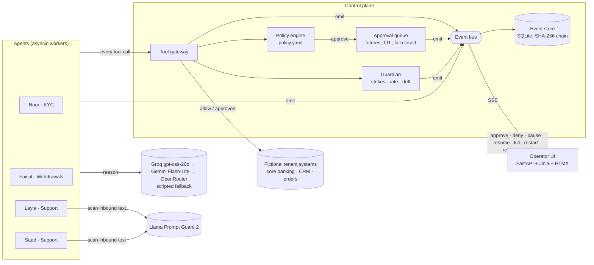

# Architecture snapshot - agent events → control plane → operator UI

## The key decision

Agents hold no credentials. The only path from an agent to a system is `Tower.gateway`, so the
tower does not have to *trust* an agent to obey a pause or a kill: revoking credentials at the
gateway makes the agent harmless even if its model keeps trying.

## Where each brief requirement is enforced

| Requirement | Mechanism |
|---|---|
| Real event stream | Persist-then-publish bus; `/stream` SSE pushes rows and coalesced refresh signals (≤1/s) |
| Approval queue | `asyncio.Future` per approval; agent awaits it inside the gateway call |
| Kill switch | Credentials revoked, worker task cancelled, approvals voided, event chained |
| Pause | `asyncio.Event` gate checked before every step and every tool call |
| Cost per agent per task | Provider `usage` on each call × list price; per-task and per-agent totals; budget auto-pause |
| Replay last N steps | The agent's own events, in order: prompt, model output, tool args, verdict, result |
| Rogue containment | Prompt Guard taint → per-call denials (strikes) → guardian quarantine → incident |
| Multi-tenant | `tenant_id` on every event, per-tenant policy, tenant-scoped views, stop and export |
| Compliance export | CSV / JSON with `prev_hash`/`hash`, chain verification endpoint and button |

## Deliberate limits (Render free tier)

- One process, in-memory fleet state, SQLite on ephemeral disk: a restart begins a fresh chain. The
  export is how evidence leaves the box. Production would put the event log on Postgres or a WORM
  store and run agents as separate workers behind the same gateway API.
- The fleet idles when nobody has watched for 10 minutes, to protect free LLM quotas.
